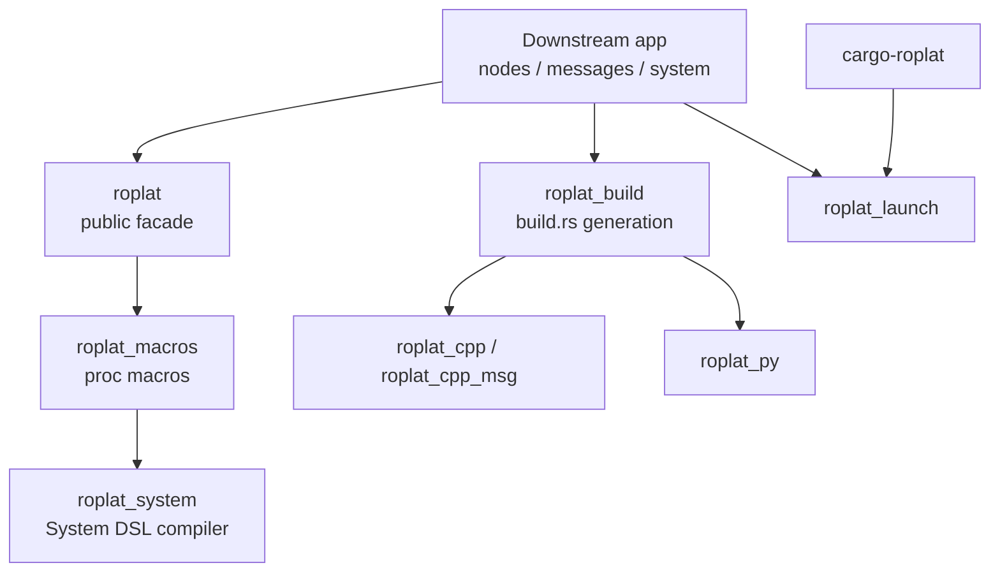

# 架构总览

Roplat 由一个 Cargo workspace 组成。对下游用户来说，最重要的是知道每个 crate 的边界。

## 分层图

## crate 职责

| crate | 职责 | 下游是否直接依赖 |
|---|---|---|
| `roplat` | 核心 facade：Node、Rhythm、comm、宏重导出 | 是 |
| `roplat_macros` | 宏实现 | 通常否 |
| `roplat_system` | System DSL 解析、图构建、调度代码生成 | 通常否 |
| `roplat_build` | build.rs two-pass 生成和 native build | 多语言项目需要 |
| `roplat_cpp` | C++ runtime headers 和 FFI 支撑 | C++ 节点需要 |
| `roplat_cpp_msg` | C++ 透明消息支持 | C++ 消息需要 |
| `roplat_py` | Python bridge 和 PyO3 | Python 节点需要 |
| `roplat_launch` | YAML arch / params / registry | launch 项目需要 |
| `cargo-roplat` | CLI | 工具命令使用 |

## 运行时路径

Rust-only 运行时很直接：

多语言运行时增加桥接：

## 构建时路径

多语言构建采用 two-pass：

1. Extract：过程宏在 `ROPLAT_PHASE=EXTRACT` 下写 manifest。
2. Generate：`roplat_build` 读取 manifest，生成 C++/Python 文件。
3. Native：可选编译 C++ FFI 和用户源。

这就是为什么多语言 crate 通常需要 `build.rs`。

## 文档阅读建议

- 写应用：先读 [快速开始](../QuickStart/00%20快速开始总览.md)。
- 理解概念：读 [概念导读](../Concepts/00%20概念导读.md)。
- 调 build.rs：读 [编译管线](01%20Pipeline.md)。
- 用 CLI：读 [CLI 工具](02%20CLI.md)。
