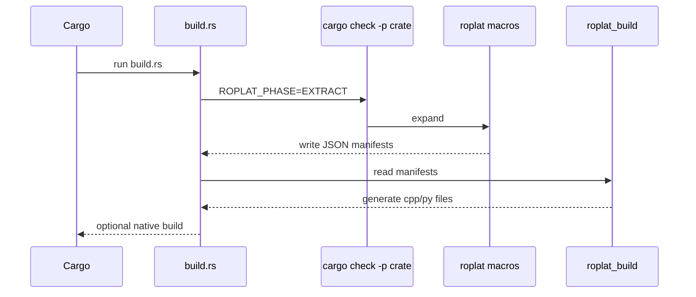

# 编译管线

Roplat 的 Rust-only 项目可以像普通 Rust crate 一样构建。只有当你使用 C++ / Python 节点、跨语言消息或生成文件时，才需要 `roplat_build`。

## Two-pass build



## 最小 build.rs

```rust
fn main() {
    if std::env::var("ROPLAT_PHASE").as_deref() == Ok("EXTRACT") {
        return;
    }

    roplat_build::BuildOrchestrator::new()
        .build()
        .expect("roplat code generation failed");
}
```

一定要在 `ROPLAT_PHASE=EXTRACT` 时直接返回，否则 extract 子进程会递归触发完整 build。

## C++ native build

```rust
use roplat_build::{BuildOrchestrator, NativeBackend, NativeBuildConfig};

fn main() {
    if std::env::var("ROPLAT_PHASE").as_deref() == Ok("EXTRACT") {
        return;
    }

    let backend = NativeBackend::from_env("ROPLAT_NATIVE_BACKEND")
        .unwrap_or(NativeBackend::Cc);

    let native = NativeBuildConfig::new()
        .backend(backend)
        .library_name("my_robot_cpp")
        .include_dir("cpp/src")
        .source("cpp/src/support.cpp");

    BuildOrchestrator::new()
        .native_build(native)
        .build()
        .expect("roplat code generation failed");
}
```

`NativeBackend::Cc` 适合简单项目；`NativeBackend::CMake` 适合需要 CMake、packages、复杂链接的项目。

## 生成目录

默认目录：

```text
cpp/
  roplat_gen/      # generated C headers, base classes, FFI cpp
  src/             # user C++ implementation
py/
  roplat_gen/      # generated ctypes stubs and base classes
  *.py             # user Python implementation
```

原则：

- `roplat_gen` 每次构建可覆盖。
- 用户文件只在缺失时生成。
- 修 generated code 的正确方式是修 Rust 声明或 roplat_build，而不是手改生成物。

## hooks

`BuildOrchestrator` 支持自定义 hook：

```rust
roplat_build::BuildOrchestrator::new()
    .after_generate(|ctx| {
        println!("cargo:warning=generated files in {}", ctx.gen_py_dir.display());
        Ok(())
    })
    .build()?;
```

适合在生成后复制资产、打印路径或接入额外工具。

## 常见环境变量

| 变量 | 作用 |
|---|---|
| `ROPLAT_PHASE=EXTRACT` | 内部 extract 阶段 |
| `ROPLAT_MANIFEST_DIR` | 宏写 manifest 的目录 |
| `ROPLAT_NATIVE_BACKEND=cc/cmake` | 选择 C++ native 后端 |

下游用户通常只需要设置 `ROPLAT_NATIVE_BACKEND`。
