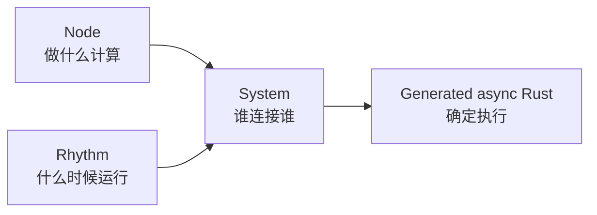

# 概念导读

Roplat 的概念页只回答一个问题：

> 写 roplat 项目前，你需要用什么方式思考系统？

先记住这张图：



## 先学三个边界

### 1. Node 不调度自己

Node 只做一次计算：

```rust
async fn process(&mut self, input: Self::Input) -> Self::Output
```

不要在 Node 里写“每 10ms 跑一次”的循环。那是 Rhythm 的职责。

### 2. Rhythm 不知道业务拓扑

Rhythm 只负责产生 tick、event、count、iterator item 或 replay frame。它不应该知道“传感器后面接控制器”。

### 3. System 不写业务算法

System DSL 只描述数据流：

```rust
timer >> {
    sensor >> filter >> controller >> motor;
};
```

滤波算法在 `filter` 这个 Node 里，而不是写在 system body 里。

## `>>` 是数据流，不是位移

在 `#[roplat::system]` 函数里，`>>` 由宏解析：

- `timer >> { ... }`：声明一个节律域。
- `source >> sink`：把前者输出接到后者输入。
- `node.output.field >> other.input.0`：显式连接字段或端口。
- `rhythm >> |event| { event >> node.input; }`：把节律产生的值送进图。

普通 Rust 代码里不要把它当 roplat 连接符使用；它只有在 System DSL 中才有这个语义。

## 主流通信和旁路通信

Roplat 有两类通信：

| 类别 | 何时使用 | 典型写法 |
|---|---|---|
| 主流数据流 | 普通节点到节点 | `a >> b >> c` |
| 旁路通信 | 跨域状态、事件流、IPC、opaque | triple buffer、ring buffer、IPC |

如果值只是一个系统图里的普通边，优先用 `>>`。不要为了“看起来灵活”手动建 sideband 通道。

## 推荐阅读顺序

1. [节点 Node](01%20Node.md)
2. [节律 Rhythm](02%20Rhythm.md)
3. [系统 System](03%20System.md)
4. [通讯模型](04%20Comm.md)
5. [录制与回放](05%20Replay.md)

读完后进入 [快速开始](../QuickStart/00%20快速开始总览.md)。
