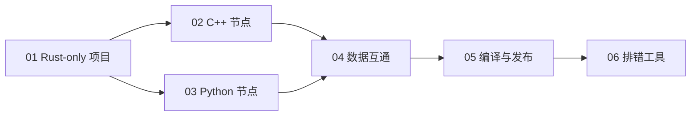

# 快速开始总览

这一组文档带你从一个 Rust-only roplat 项目开始，逐步扩展到 C++、Python、跨语言消息和构建诊断。

## 准备环境

必需：

```powershell
rustc --version
cargo --version
```

roplat 使用 Rust 原生 `async fn in trait`，需要 Rust 1.75+。

多语言可选依赖：

```powershell
# C++ 节点
cmake --version
cl.exe /?       # Windows MSVC
g++ --version   # Linux GCC

# Python 节点
python --version
```

## 推荐路径



先跑通 Rust-only，再接入多语言。不要一开始就把 build.rs、C++、Python、IPC 全部混在一起。

## 最小项目形状

```text
my_robot/
  Cargo.toml
  src/
    main.rs
    msg.rs
    nodes.rs
```

`main.rs` 写 `#[roplat::system]`，`nodes.rs` 写 Rust nodes，`msg.rs` 写共享消息。

多语言项目再增加：

```text
my_robot/
  build.rs
  src/puppet.rs
  cpp/src/
  cpp/roplat_gen/
  py/
  py/roplat_gen/
```

## 第一个心法

如果你正在写：

```rust
loop {
    let x = node.process(input).await;
}
```

先停下来，问一句：

> 这个循环应该由哪个 Rhythm 表达？

通常答案是 `SysTimer`、`CountRhythm`、`EventRhythm` 或 iterator rhythm。

## 运行示例

在 roplat 主仓内：

```powershell
cargo run -p hello
cargo run -p chain_mixed
cargo run -p multi_lang --example rs_py
cargo run -p ipc_pubsub --bin publisher
```

如果你只是学习 DSL，优先看 `examples/macros/examples/hello_world.rs`。
