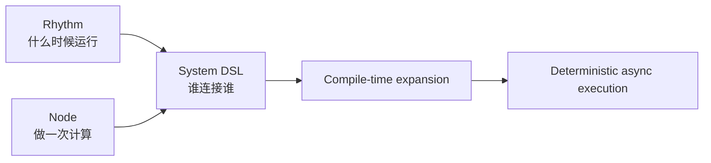

---
hide:
  - navigation
---

# Roplat

<div style="text-align: center; margin: 2em 0 2.5em;">
<strong>Code-first robot applications for Rust, C++ and Python.</strong><br>
<em>用 Node / Rhythm / System 把机器人系统的拓扑、节奏和类型关系提前交给编译器检查。</em>
</div>

**Roplat** 是一个 Rust 编写的机器人应用框架。它不把机器人程序组织成“若干运行时发现的节点和话题”，而是让你在代码中直接声明计算节点、节律域和数据流拓扑，由过程宏在编译期展开为确定的执行图。

它适合这样的场景：

- 你希望控制链路、感知管线或实验系统有明确的数据流和执行顺序。
- 你不想为了简单周期任务手写 `loop`、`sleep`、`tokio::spawn` 和通道粘合代码。
- 你需要在同一个系统里组合 Rust、C++、Python 节点，但不想长期维护手写 FFI。
- 你希望消息类型、图拓扑、跨语言绑定和 IPC schema 尽早失败，而不是在真机实验时失败。

```rust
#[roplat::system]
async fn main() {
    let mut source = SensorNode::new();
    let mut filter = FilterNode::new();
    let mut ctrl = ControllerNode::new();
    let mut motor = MotorNode::new();
    let mut timer = roplat::rhythm::SysTimer::new(std::time::Duration::from_millis(10));

    timer >> {
        source >> filter >> ctrl >> motor;
    };
}
```

## 核心优势

<div class="grid cards" markdown>

- :material-graph-outline:{ .lg .middle } **代码即拓扑**

    ---

    用 `#[roplat::system]` 和 `>>` 描述节点连接。图结构留在代码里，而不是散落在回调、线程和运行时注册表中。

- :material-clock-fast:{ .lg .middle } **节律域驱动**

    ---

    周期、事件、计数、迭代和回放都由 Rhythm 表达。业务代码不需要手写调度循环。

- :material-shield-check:{ .lg .middle } **编译期检查**

    ---

    节点输入输出、消息布局、系统拓扑、部分死锁风险和跨语言绑定尽可能在构建阶段暴露。

- :material-translate:{ .lg .middle } **多语言组合**

    ---

    Rust 原生节点是基础；C++ 与 Python 节点通过 `roplat_build` 和语言桥接生成 glue code。

</div>

## 三个核心抽象



| 抽象 | 负责什么 | 你应该写什么 |
|---|---|---|
| `Node` | 单次输入到输出的计算 | 控制器、滤波器、驱动适配器、感知处理 |
| `Rhythm` | 执行节奏和触发源 | 定时器、事件触发、计数测试、离线迭代、回放 |
| `System` | 节点拓扑和数据流 | `timer >> { sensor >> filter >> ctrl; };` |

## 你从哪里开始

<div class="grid cards" markdown>

- **第一次了解 Roplat**

    [:octicons-arrow-right-24: 项目介绍](Guide/01%20Introduction.md)

- **马上写一个项目**

    [:octicons-arrow-right-24: 快速开始总览](QuickStart/00%20快速开始总览.md)

- **理解 Node / Rhythm / System**

    [:octicons-arrow-right-24: 概念导读](Concepts/00%20概念导读.md)

- **集成 C++ / Python / build.rs**

    [:octicons-arrow-right-24: 编译管线](Architecture/01%20Pipeline.md)

</div>

## 当前边界

Roplat 的核心 Node / Rhythm / System、多语言桥接、IPC MVP、录制回放核心 API 已经可用。部分更高层接口仍在演进，例如 `#[system(record = ...)]` 风格的完整宏集成、更多本地 IPC 后端、以及 resource 子系统的重新启用。文档中会明确区分“推荐使用路径”和“内部/实验性能力”。
