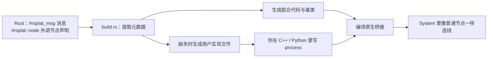

# C++ 与 Python 节点

已有的 C++ 或 Python 算法可以作为节点接进 System。工程仍然是一个 Rust 项目：Rust 声明消息和节点接口，构建脚本生成胶合代码和可编辑的外语文件，C++ / Python 只实现节点的算法；Rhythm 和 System 的组织留在 Rust。

!!! note "本页的验证范围"
    本站的完整程序只覆盖纯 Rust。下面的外语流程来自 roplat 0.5 的构建工具，本站尚未用 crates.io 上的 `roplat_build`、`roplat_cpp`、`roplat_py` 包独立复现，签名以 [docs.rs](https://docs.rs/roplat_build/0.5.0/roplat_build/) 为准。

## 流程



1. **声明消息。** 跨语言传递的数据用 `#[roplat::roplat_msg]` 标注 `#[repr(C)]` 结构体，构建时生成 C 头文件和 Python 类型。
2. **声明节点。** 在 Rust 里用 `#[roplat::node(lang = "cpp", input(…), output(…))]`（Python 为 `lang = "py"`）声明一个外语节点的端口和配置字段。这个 Rust 结构体是接口声明，不是算法本身。
3. **构建脚本。** `build.rs` 使用 `roplat_build::BuildOrchestrator`：先通过一次检查触发过程宏写出元数据，再生成文件，最后编译 C++ 桥接（`cc` 或 `cmake` 后端）。
4. **实现算法。** 在生成的用户文件里实现 `process`。
5. **连线。** 在 System 里照常写 `source >> forward >> sink;`。

## 依赖

```toml
[dependencies]
roplat = "0.5.0"
roplat_py = "0.5.0"       # 有 Python 节点时
tokio = { version = "1", features = ["macros", "rt-multi-thread", "sync", "time"] }

[build-dependencies]
roplat_build = "0.5.0"
```

C++ 节点的胶合由 `roplat_build` 生成并编译，需要本机有 C++ 工具链（使用 `cmake` 后端时还需要 CMake）。crates.io 上还有 `roplat_cpp`、`roplat_cpp_msg` 等 C++ 相关的包，用途以它们在 docs.rs 上的说明为准。

## 声明一个 C++ 节点

```rust
#[roplat::roplat_msg]
#[repr(C)]
#[derive(Clone, Debug, PartialEq)]
pub struct Packet {
    pub id: u64,
    pub value: f64,
}

#[roplat::node(
    lang = "cpp",
    input(input, Packet),
    output(output, Packet)
)]
pub struct CppForward {
    pub scale: f64,
}
```

```rust
// build.rs
use roplat_build::{BuildOrchestrator, NativeBackend, NativeBuildConfig};

fn main() {
    // 提取阶段由过程宏完成，构建脚本直接返回。
    if std::env::var("ROPLAT_PHASE").as_deref() == Ok("EXTRACT") {
        return;
    }
    let native = NativeBuildConfig::new()
        .backend(NativeBackend::Cc)
        .library_name("my_nodes_cpp")
        .include_dir("cpp/src");
    BuildOrchestrator::new()
        .native_build(native)
        .build()
        .expect("code generation failed");
    println!("cargo:rerun-if-changed=src/");
    println!("cargo:rerun-if-changed=cpp/src/");
}
```

构建后，`cpp/roplat_gen/` 下是生成器管理的基类、消息头文件和 FFI 胶合，每次构建都会重写；`cpp/src/` 下是你的实现文件，只在缺失时生成一次：

```cpp
class CppForward : public CppForwardBase, public roplat::Node<Packet, Packet>
{
public:
    Packet process(const Packet &input) override
    {
        Packet out;
        out.id = input.id;
        out.value = input.value * 2.0;
        return out;
    }
};
```

不要把算法写进 `roplat_gen/` 下的文件，下次构建会覆盖它们。

## Python 节点

声明时写 `lang = "py"`，生成的 Python 用户文件形如：

```python
class PyForward(PyForwardBase, Node):
    def process(self, input_data: Packet) -> Packet:
        out = Packet()
        out.id = int(input_data.id)
        out.value = float(input_data.value) + self.bias
        return out
```

Python 节点需要匹配的 Python 开发环境。共享帧的只读视图需要可选的 buffer 扩展；扩展模块和嵌入解释器两种用法要分开构建，不要对整个工作区一次打开所有特性。

## 已知边界

- Rust 声明里的配置字段目前不会自动同步到外语实现；增加参数前先确认生成的接口提供了对应通路。
- 透明 Python 节点在启用时验证并缓存消息布局，返回时检查类型和长度，但不检查 `bool` 等受限字段的位模式。节点放在周期内部时，每个周期都会重新支付这份初始化成本。
- 桥接里的失败目前走 panic，不属于合作式的失败与对象归还保证。
- Python 不透明节点的旧交接方式不支持任意多个在途调用、同类型分支并发和线程迁移。
- 跨语言传递不等于端到端零复制：Python 读取小消息得到的是副本。

需要逐条处理或跨进程的数据交换，见[通信](../concepts/communication.md)。
