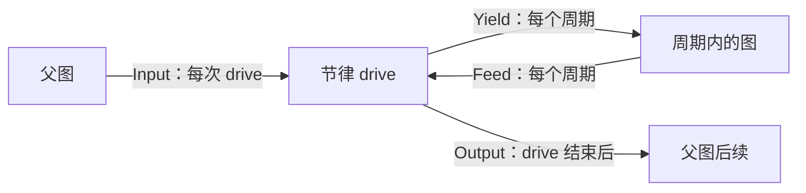

# 节律的四个边界

上一篇的迭代器节律只往图里送值，不要求图交回什么。真实的控制节律是双向的：每个周期把设备状态交给图，图算出指令交回节律，节律把指令发给设备，再决定是否继续。本篇亲手写一个这样的节律，分清四种值。

## 四种值

| 名称 | 方向 | 次数 | 本例 |
|---|---|---|---|
| `Input` | 父图 → 节律 | 每次 drive 一份 | 目标位置 |
| `Yield` | 节律 → 周期内的图 | 每个周期一份 | (当前位置, 目标) |
| `Feed` | 周期内的图 → 节律 | 每个周期一份 | 速度指令 |
| `Output` | 节律 → 父图 | 每次 drive 结束时一份 | 用了几个周期、停在哪里 |



**drive** 是节律的一次完整运行：从收到 Input 开始，经过若干周期，到交出 Output 结束。父图要等这次 drive 完全结束才拿到 Output。

## 完整程序

`Approach` 节律驱动一个模拟轴走向目标，误差小于容差或用满周期数时结束；`Proportional` 是周期内的控制律。

<!-- roplat-example: rhythm-boundaries -->
```rust
use std::future::Future;

use roplat::rhythm::Rhythm;
use roplat::{Completion, Execution, ExecutionContext, Lifecycle, Node, RoplatError, RoplatResult};

const DT: f64 = 0.1;

/// 驱动一个模拟轴走向目标的节律。轴由节律自己持有，所以不借用资源。
struct Approach {
    position: f64,
    tolerance: f64,
    max_cycles: usize,
}

/// 一次 drive 的总结。
#[derive(Debug)]
struct Report {
    cycles: usize,
    position: f64,
}

impl Lifecycle for Approach {
    type Error = RoplatError;
}

impl Rhythm for Approach {
    type Resources = ();
    type Input = f64; // 目标：每次 drive 一份
    type Yield = (f64, f64); // (当前位置, 目标)：每周期一份
    type Feed = f64; // 速度指令：每周期一份
    type Output = Report; // 整次 drive 结束时一份

    async fn drive<N, F, Fut>(
        &mut self,
        mut nodes: N,
        mut cycle: F,
        target: f64,
        (): (),
        context: ExecutionContext,
    ) -> (Execution<Report>, N)
    where
        N: Send,
        F: FnMut(N, (f64, f64), ExecutionContext) -> Fut + Send,
        Fut: Future<Output = (Execution<f64>, N)> + Send,
    {
        let mut cycles = 0;
        while (target - self.position).abs() > self.tolerance && cycles < self.max_cycles {
            if context.is_stopping() {
                return (Ok(Completion::Stopped), nodes);
            }
            let (execution, returned) =
                cycle(nodes, (self.position, target), context.clone()).await;
            nodes = returned; // 先收回对象，再看这个周期的结果
            match execution {
                Ok(Completion::Completed(velocity)) => {
                    self.position += velocity * DT;
                    cycles += 1;
                }
                Ok(Completion::Stopped) => return (Ok(Completion::Stopped), nodes),
                Err(error) => {
                    context.request_stop();
                    return (Err(error), nodes);
                }
            }
        }
        let report = Report {
            cycles,
            position: self.position,
        };
        (Ok(Completion::Completed(report)), nodes)
    }
}

/// 比例控制律：输入 (位置, 目标)，输出限幅后的速度。
struct Proportional {
    gain: f64,
    limit: f64,
}

impl Lifecycle for Proportional {
    type Error = RoplatError;
}

impl Node for Proportional {
    type Resources = ();
    type Input = (f64, f64);
    type Output = f64;

    async fn process(&mut self, (position, target): (f64, f64), _: ()) -> f64 {
        (self.gain * (target - position)).clamp(-self.limit, self.limit)
    }
}

#[roplat::system]
async fn move_axis(approach: &mut Approach, target: f64) -> RoplatResult<Report> {
    let mut law = Proportional {
        gain: 2.0,
        limit: 1.0,
    };

    &target >> approach.input;
    approach
        >> |(position, goal)| {
            position >> law.input.0;
            goal >> law.input.1;
            law
        };

    Ok(approach.output)
}

#[tokio::main(flavor = "current_thread")]
async fn main() -> RoplatResult<()> {
    let mut approach = Approach {
        position: 0.0,
        tolerance: 0.01,
        max_cycles: 100,
    };
    for target in [1.0, 0.5] {
        let report = move_axis(&mut approach, target).await?;
        println!(
            "target {target:.1}: {} cycles, position {:.3}",
            report.cycles, report.position
        );
    }
    Ok(())
}
```
<!-- /roplat-example -->

输出：

<!-- roplat-output: rhythm-boundaries -->
```text
target 1.0: 23 cycles, position 0.991
target 0.5: 18 cycles, position 0.509
```
<!-- /roplat-output -->

## 在图里怎样对应

```rust
&target >> approach.input;
approach >> |(position, goal)| {
    position >> law.input.0;
    goal >> law.input.1;
    law
};
```

- `&target >> approach.input` 把函数参数的一份副本作为本次 drive 的 Input。`&value` 是把普通 Rust 值送进图的写法；只写 `target >> ...` 时，裸名字会被当成节点。
- `|(position, goal)|` 绑定每个周期的 Yield，并按元组解构。
- `.input.0`、`.input.1` 把两个来源装配成 `law` 的元组输入。编号决定元组位置，与语句先后无关。
- 周期域最后是 `law`，**没有分号**：`law` 的输出就是本周期的 Feed。写成 `law;` 时 Feed 变成 `()`，与 `Approach` 要求的 `f64` 不符，编译报错。
- 尾段 `Ok(approach.output)` 读取本次 drive 的 Output。在尾段里引用图的结果要写 `.output`。

也可以把 Input 写在节律前面：`source >> approach >> |(position, goal)| { ... };`，`source` 的输出整体成为 Input。

## 写节律的规则

`drive` 的签名看起来复杂，规则只有几条：

1. **每个周期开始前检查停止。** `context.is_stopping()` 为真时不再开始新周期，返回 `Stopped`。
2. **完整等待周期结束。** `cycle(nodes, yield, context)` 返回一个 Future；拿到结果之前不要用超时或 `select!` 丢弃它。
3. **先收回对象，再看结果。** 周期把 `nodes` 交回来。不管这个周期成功、停止还是失败，都要把它带回调用方。
4. **失败时请求停止并返回。** 周期返回错误时调用 `context.request_stop()`，把错误和 `nodes` 一起交回。

`nodes` 的类型 `N` 由 System 宏决定，里面可能是对象本体，也可能是可变借用。节律不需要也不应该关心它的内容，只负责每次都把它交回去。

## 对象跨 drive 保留状态

`main` 两次调用 `move_axis`，用的是同一个 `approach`。第二次 drive 从第一次停下的位置（0.991）出发，走向 0.5。System 只使用参数传进来的对象，不会在每次 drive 时重置它，也不负责它的启用与关闭；需要重新开始时，由调用方创建新对象或显式重置。

## 要点

- 节律拥有循环：周期何时开始、何时结束整次 drive，由节律决定，图里没有 `loop`。
- Feed 是每个周期的值，Output 是整次 drive 的值，两者可以是完全不同的类型。
- 父图依赖子节律的 Output 时，要等子节律这次 drive 全部结束。

下一篇：[借用设备](resources.md)，把机械臂交给节点使用。
